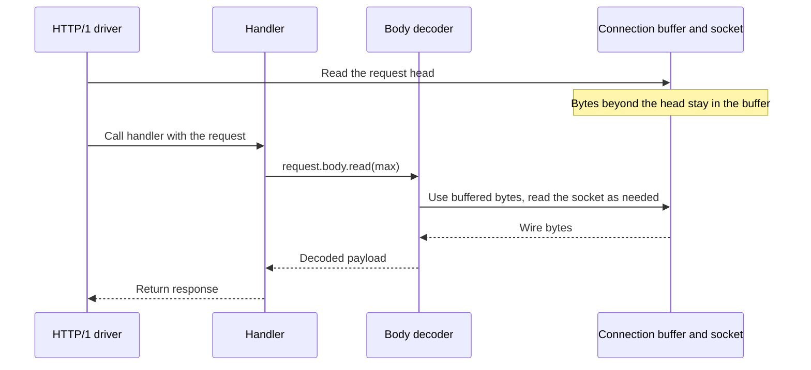
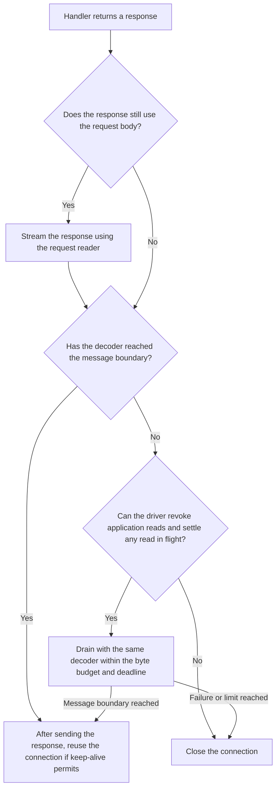

# HTTP client and server design

The shared messages and HTTP/1 codec are implemented in [thesis/http](../packages/http/README.md).
Its [package notes](../packages/http/AGENTS.md) record the decisions behind them.
The HTTP/1 server POC now lives in [thesis/http-server](../packages/http-server/README.md). Its entry point
binds its configured endpoint when `run()` starts, and it closes a connection after an unread body. The client and the extensions
to the server described below remain proposals.

## One set of messages for both directions

`Request` and `Response` live in `thesis/http` and are used by the client and the server alike: there is no
`ServerRequest` or `ClientResponse`. The reason is proxies and gateways: in amphp `http-client` and `http-server`
have a `Request` each, and proxying means converting one into the other. Go has one `http.Request` for both
sides and it works, but its request also carries fields that mean something on the server only (`RemoteAddr`,
`TLS`, `RequestURI`): empty and meaningless in a request the client builds. We don't repeat that.

The rule: **a message holds the semantics of HTTP only, the transport goes beside it.**

```php
// thesis/http, shared by the client and the server
// Request properties
string $method;
Uri $uri;
Headers $headers;
Reader $body;
?Headers $trailers;

// Response properties
int $status;
Headers $headers;
Reader $body;
?Headers $trailers;
```

The proposed server passes connection information to the handler as a second argument:

```php
// thesis/http-server, the server only
final readonly class Context
{
    public SocketAddress $remoteAddress;
    public SocketAddress $localAddress;
    public ?TlsInfo $tls;
    // later: upgrade for WebSocket, 103 Early Hints, the parameters of the router
}

HttpServer\listen(
    address: '0.0.0.0:8080',
    handler: static function (Request $request, Context $context): Response {
        return new Response(status: 200, body: new StringReader("hello {$context->remoteAddress}"));
    },
);
```

A handler that does not need the context does not declare it: PHP passes an extra argument to a closure
silently, so the simple handler stays `static fn(Request $request) => new Response(...)`.

## The client and the handler have one shape

The proposed client is `callable(Request): Response`, the handler of the server is `callable(Request, Context): Response`
(the server as a function, as in Finagle). Then:

- middleware that only needs messages can use `callable(Request, next): Response`:
  a header transformation or message logger can serve both sides. Retries need client-side attempt state;
  server access logs need connection context and the outcome of writing the response;
- a proxy is almost one line:
  ```php
  handler: static fn(Request $request) => $client(
      clone($request, ['uri' => $request->uri->withHost('backend')]),
  ),
  ```
- a test calls the handler directly, without a socket, and a client pointed at a handler is an in-memory transport.

## The body

The body is where the two directions differ:

| | Outgoing (client request, server response) | Incoming (client response, server request) |
|---|---|---|
| Created by | the user | the parser of the connection |
| Length | often known | from the headers, may be unknown |
| Replay | a new body is needed for a redirect (307/308) or a safe retry | the connection stream can be read once |
| Lifetime | free | tied to the connection: it is not back in the pool until the owner reaches the message boundary or discards the connection |

Messages expose `Io\Reader` directly.
`Http1\FixedLengthReader` enforces a declared length, and `Http1\ChunkedReader` consumes the terminating
chunk and its trailers. The connection owner manages the lifetime of readers that borrow it.

Amp has four body APIs. An outgoing client request uses `HttpContent`, whose `getContent()` returns a fresh
stream for each attempt or throws. An incoming client response exposes a final `Payload`. A server request
exposes a final `RequestBody` with a size-limit control. A server response exposes `ReadableStream`.
For Thesis, a shared body lets a proxy pass an incoming stream directly to an outgoing message.

A message and its clone share the body's read position. Revisit how the client obtains a fresh body when it
supports redirects or retries that resend a body. One option is a factory that the client calls during
attempt preparation, so opening the reader can suspend there.

Consider an `IterableReader` in `thesis/io` for generators and other iterables of byte strings.
`new IterableReader($chunks)` would consume an iterable once. Each new attempt would need
a fresh iterable and reader.
Amp's `ReadableIterableStream` can return a whole yielded string. Thesis promises at most `$max` bytes:
keep the current string and offset, advance the iterable only when the next read needs another chunk,
skip empty strings and signal exhaustion with `UnexpectedEof`. A read that throws must lose no bytes.

A streaming response of the server (SSE, a large file) is a `Response` whose body is a pipe, and the writer
runs as a child task. Cancellation comes from the task tree: the client disconnected, the scope of the request
is cancelled.

## Independent of the protocol version

A message is the same for HTTP/1.1 and HTTP/2, otherwise grpc rewrites it:

- The HTTP/1 codec derives body framing from the reader and trailers. A response to `HEAD` or a 304 can
  carry `Content-Length` as representation metadata. Status 1xx and 204 always forbid the field.
- The request URI supplies the authority for `Host` and, in a future HTTP/2 codec, `:authority`.
- **trailers are in the model from the first version**, gRPC needs them. On a message, `$trailers` holds ready
  fields or reports that they are pending. A callback may read the current reader's state without I/O or suspension.

### Choosing HTTP/1 framing when sending trailers

HTTP/1.1 uses chunked framing when trailers are nonempty, pending or announced by `Trailer`, including when
the reader has a known size. The sender can read the trailer state after finishing the body and pass the
ready fields to `encodeLastChunk()`. HTTP/1.0 and responses without a body reject trailers.

### How the connection owner learns that an incoming body ended

The client needs to know when it can return an HTTP/1 connection to the pool. The server needs to know
when it can parse the next request. The framing determines when the incoming message is complete:

- A fixed-length body ends on the read that delivers its last byte. A zero-length body is complete
  as soon as the head is parsed, even if the application never calls `read()`.
- A chunked body ends once the decoder consumes the zero chunk and the entire trailer section.
- A close-delimited response ends at connection EOF. That connection has already closed.

If the application stops reading early, the owner can drain the remaining body within a limit or close
the connection. The body readers expose only `read()` for I/O. A framing error or premature EOF makes
the connection unusable. How the exchange observes completion and abandonment is still open.
The [two-message test](#two-messages-on-one-http1-connection) below exercises this choice.

### Who reads the request body on an HTTP/1 server?

In Amp's `http-server` 3.4.9, `Driver/Http1Driver.php` owns the socket for the whole connection.
Once it has the request head, it starts the handler with `async()` and feeds decoded payload to a
`Queue` behind `RequestBody`. A handler reading an empty queue waits. The driver pushing to the
default zero-capacity queue can also wait until the consumer takes the chunk. If the consumer disposes
the queue early, the driver can continue reading and discarding the remaining body within its limits.
After completing the body it waits for the response before parsing the next request.

For Thesis HTTP/1, start with demand-driven reads. The handler's `$request->body->read()` asks the decoder for
bytes from the connection buffer and, when necessary, the socket. A slow handler naturally sets the
pace. A slow peer suspends the fiber doing the read. This avoids a per-request queue and producer task.



The server driver owns cleanup. If the handler returns early, first account for any response that
still consumes the request body (an echo response can share that reader). Let that consumer finish or close the connection if transmission fails. Before draining, revoke application reads through the old body and settle any read in flight.
The driver can then resume the same decoder at its current position, including bytes already buffered,
and discard the remainder within a byte budget and a deadline. Only a clean message boundary permits
parsing the next request. Close the connection if exclusive ownership or bounded draining fails.



The existing `Thesis\Http\Http1` codec lives in `thesis/http`. The client formats request heads and
parses response heads. The server does the reverse. Both need the same framing rules. For example, a response
to HEAD ends after the fields even when Content-Length describes the size of the representation.

The head parsers accept a complete head as a string. `FixedLengthReader` reads the declared number of bytes.
`ChunkedReader` decodes chunks and trailers.
Reading a whole message still requires finding the end of the head within a byte limit, preserving any body
bytes already in the buffer, and constructing the appropriate body reader. The HTTP/1 implementation could
share this work between client and server. Timeouts, pooling and the choice to drain or close a connection
belong to its owner.

If HTTP/2 is planned, consider extracting `thesis/http1` when the first client or server uses it.
Both `thesis/http1` and a future `thesis/http2` could depend on the shared messages in `thesis/http`.
An HTTP/2 implementation needs connection-wide HPACK state, flow control and dispatch of interleaved frames
to individual streams. Applications can still read each stream through the same `Reader`. Defer a common codec
interface until both implementations have callers that need one.

## Comparison with the installed Amp stack

The reference versions are `amphp/http` 2.1.2, `amphp/http-client` 5.3.8 and `amphp/http-server` 3.4.9.

- **Common HTTP.** Amp shares abstract message classes, header and query helpers, status codes,
  and request and response cookie syntax. Its HTTP/1 helper parses and formats header fields.
  Its HTTP/2 parser sends frame events to a processor implemented on each side. In Thesis the shared
  package already has concrete messages, immutable multi-value headers, and HTTP/1
  request and response heads, framing and chunked bodies. Cookie field parsing could also be shared:
  each Set-Cookie field is a separate value. Cookie storage and selection for an outgoing request
  would be client policy.
- **Client.** Amp owns concrete messages, upload content and multipart forms, connection factories and pools,
  HTTP/1 response parsing, the HTTP/2 connection processor, interceptors, and transfer events.
  See `Connection/ConnectionPool.php`, `ApplicationInterceptor.php`, `NetworkInterceptor.php`
  and `Interceptor/RetryRequests.php` in its source.
- **Server.** Amp owns concrete messages, handler and middleware contracts, socket acceptance and limits,
  HTTP/1 and HTTP/2 drivers, upgrades, error handling and lifecycle. Its middleware includes access logs,
  compression, trusted forwarding and handler concurrency limits. See `SocketHttpServer.php`,
  `Driver/Http1Driver.php` and `Middleware/ConcurrencyLimitingMiddleware.php` in its source.

### Ideas for the first client and server

1. Have the client pool reserve capacity for one exchange. With HTTP/1 that can occupy the connection
   until the response body ends. With HTTP/2 other streams can still use the connection. An early body
   close should release or discard the corresponding resource according to the protocol.
2. Distinguish one application request from each network attempt. Redirects and retries can create several
   attempts, while a cache hit can create none. A retry needs both permission to repeat the operation
   (idempotence or evidence the peer did not process it) and a body available for the new attempt.
   A cross-origin redirect needs an explicit policy for credentials. Keep this state in the client.
3. Treat receiving the response head and finishing the response body as separate observable events.
   A response returned by the client can still fail during reading. The same distinction matters to a
   server access log when a handler returns a streaming response and the peer disconnects during writing.
4. Budget accepted connections and active requests separately on the server. HTTP/2 lets a single
   connection occupy many handlers. Consider how stopping the listener drains active exchanges under
   a deadline, including handlers that already returned a streaming body.

## The client and the lifetime of a response

If `send()` just returns a `Response`, a user who does not read the body to the end keeps the connection.
The options:

1. `send(Request): Response`. The client must reclaim the connection when the caller abandons an unread body.
2. Structured: `send(Request, callable(Response): T): T`, the client reclaims the connection after the callback. In the spirit
   of `async`, but awkward when the response is passed on (a proxy).

The proposal uses the first option and ties the incoming body to the scope of the task that called `send()`.
When the scope ends, the client returns a reusable connection to the pool or closes it. A proxy works, and a leak lasts
no longer than the task. To check on `async`: whether such a binding works without cycles (the trap of
fiber keys in `agents/fibers.md`).

## Smaller points to settle early

- **URI.** Thesis uses `Uri\Rfc3986\Uri`; client input normalization belongs at the client boundary.
  Whether a proxy or request signer also needs the exact original request-target remains worth testing.
- **Headers.** The shared immutable `Headers` supports case-insensitive names and repeated string values.
- **1xx.** The server sends `100 Continue` by itself on the first read of a body for which the client requested `100-continue`, `103 Early Hints`
  goes through `Context`.
- **Upgrade (WebSocket)** goes through `Context` too: the handler takes the connection over, the message
  knows nothing about it.

## Security of the server

Zero CVEs cannot be promised, but whole classes of them can be made impossible by design and the rest hunted
by tests aimed at them. The CVEs of HTTP/1.1 servers (nginx, Node/llhttp, Go, Netty, Puma, amphp, Apache)
fall almost all into the classes below.

### Principles

- On malformed input the codec throws `MalformedMessage`. The server should use its status
  (400, 431, 501 or 505) and close the connection.
- Head parsers take bytes and return a head. Body readers take a shared buffer and a `Reader`.
  Both can run against in-memory inputs. The client uses the same codec to parse responses.
- The planned server needs default limits on head and body bytes and deadlines for connection I/O.

### Request smuggling (desync)

The server and a proxy in front of it disagree on where a request ends. Rejected:

- `Content-Length` together with `Transfer-Encoding`;
- several `Content-Length` fields or a list (`5, 5`); a value of anything but digits (no `+`, spaces, `0x`)
  or longer than 18 digits (all accepted lengths fit in a signed 64-bit integer);
- `Transfer-Encoding` other than a single `chunked` coding, and any `Transfer-Encoding` in HTTP/1.0;
- in chunked: a size that is not hex or has too many digits, chunk extensions over a limit (CVEs of Go and Node
  in 2023), anything but `\r\n` after the data;
- a bare `\n` or `\r` instead of `\r\n`, obs-fold (a header continued on a line starting with a space),
  whitespace between a field name and `:`;
- a field name that is not a token, a field value with CR, LF or NUL;
- a missing or repeated `Host` in HTTP/1.1. When `Host` and the absolute-form disagree, the absolute-form wins;
- fields of trailers are never merged into the headers, and framing and routing fields (`Content-Length`,
  `Host`, `Transfer-Encoding`, ...) are forbidden there.

The codec chooses the framing. The sender must count bytes for a fixed-length response and close the
connection if the reader ends before it has sent the declared length.

Pipelining and an unread body: the next request is parsed strictly after the end of the body of the previous one.
When the handler answers without reading the body, the server drains the rest within a limit or closes
the connection. A broken body closes the connection as well.

### Response splitting

User data ends up in headers (`Location` from the query string and the like). `Headers` validates names and
values when it is created: CR, LF or NUL in a value is a `\ValueError`, a mistake of the caller. The response parser checks the incoming reason phrase for control characters.
The formatter supplies its own reason phrase from the status code. With this invariant there is no "escape it later": a string with CRLF cannot get into
`Headers` at all.

### Denial of service

The main practical class for PHP.

| Attack | Defense |
|---|---|
| Slowloris (headers byte by byte) | a timeout on the whole header section, not on each read |
| a slow body | an idle timeout on reads of the body, a minimal rate |
| a slow reader of the response | a write timeout |
| a huge request line or headers | limits: ~8 KiB for the request line, ~16–64 KiB for all fields, ~100 fields |
| a huge body | a size limit, checked before `100 Continue`, not after |
| endless keep-alive or pipelining | an idle timeout, a limit of requests per connection, a bounded queue of responses |
| many connections | a limit of connections, in total and per IP |
| quadratic parsing | look for `\r\n\r\n` from where the previous search stopped, not from the start of the buffer |
| hash flooding | the limit of fields (see below) |
| ReDoS | no backtracking regular expressions in the parser: `strspn()`, `strcspn()`, `strpos()` |
| a decompression bomb | no decoding of an incoming `Content-Encoding` by default, a limited output otherwise |

The hash of PHP arrays is not randomized: thousands of colliding field names make insertion quadratic.
The limit of fields closes it, and the form parser limits its fields too (like `max_input_vars`).
A decoded body is limited by the reader that feeds `inflate_add()` 8 KiB at a time (see the roadmap).

### Numbers and paths

- Numbers (`Content-Length`, the chunk size, `Range`) are parsed by hand with a check of digits and length:
  `(int)`, `intval()` and `hexdec()` silently accept garbage or turn into a float.
- The request-target is kept raw and decoded once. The router compares decoded segments, `%2F` inside a segment
  and `%00` are rejected, nothing is decoded twice, `..` is not silently normalized. Static content depends
  on it (path traversal).
- `Host` and `X-Forwarded-*` are not trusted: `X-Forwarded-*` only from configured proxies. Host header poisoning
  (links in password reset emails) is the level of the application, document trusted host configuration when the server is implemented.

### Errors and leaks

- An exception of the handler is a `500` without the message and the trace, the details go to the log only.
- A handler that fails after the response has started closes the connection: the client must not take
  a truncated response for a complete one.
- No body for `HEAD`, `1xx`, `204`, `304` or a successful `CONNECT`. A handler that returns one there is an error, not a silent drop.
- Request data is escaped in logs (log injection).

### RFC conformance tests

For each supported rule, record the RFC section, the role (sender or recipient), the input and the observable
outcome. Where an RFC permits several outcomes, identify the policy Thesis chooses.
Use [RFC 9110](https://www.rfc-editor.org/rfc/rfc9110.html) for shared semantics and
[RFC 9112 §6.3](https://www.rfc-editor.org/rfc/rfc9112.html#section-6.3) for HTTP/1 body length.

For the future sender, check the complete wire output of a known-length body with trailers.
Check that HTTP/1.1 uses chunked framing and calls the trailer producer after reading the payload. Give the
decoder a hand-written message and check the body, trailers and unread bytes separately. For HTTP/1.0, assert that sending fails before the first write. Keep round trips as a further check:
an encoder and decoder can agree on the same mistake. See
[RFC 9112 §7.1](https://www.rfc-editor.org/rfc/rfc9112.html#section-7.1).

#### Two messages on one HTTP/1 connection

Start with a chunked message with trailers immediately followed by a second message in the same input buffer.
On the server use two requests. On the client supply responses for two outstanding requests in order.
Check the exact payload and trailers the application receives and the bytes remaining at the next head.
Run the exchange with each single split position, one byte per read, and the whole input in one read.

| First incoming message | Observable completion |
|---|---|
| Zero-length body | Complete when the head is parsed, even if the application never reads. |
| Fixed-length body | Complete on delivery of the last byte, without an extra read. |
| Chunked body | Complete after the zero chunk and the entire trailer section. |
| Response to HEAD with Content-Length | Complete at the head. The length describes the representation. |
| Application stops reading early | Reuse requires a successful bounded drain. Otherwise the owner closes the connection. |
| Premature EOF in a fixed-length or chunked body | Reading fails and the owner discards the connection. |

Observe the server through delivery of the second request to its handler. For the client pool, also run two
sequential exchanges with a single connection slot: check when the next request can acquire it, and whether
it gets the same connection or a fresh one. Completing an exchange must release its slot only once.
A close-delimited response gets a separate case since EOF completes the body and ends the connection.

#### Resource limits, cancellation and interoperability

- Exercise each configured byte or field limit just below, at and above the boundary. Check how much the reader
  requested or buffered before rejection, including when draining an abandoned body.
- Use virtual time to distinguish a deadline for the entire head from an idle timeout on the body. After a
  retryable cancelled read, check exact byte delivery. After a terminal framing error, check disposal and that
  the server dispatches no further request on that connection.
- Keep deterministic regression fixtures for relevant parser failures, including cases from llhttp and h11.
  Supplement them with bounded fuzzing of the in-memory codec using [PHP-Fuzzer](https://github.com/nikic/PHP-Fuzzer). Save the seed and minimized input of a failure.
  Check termination, resource bounds and the unread suffix as well as decoded output.
- In CI, exercise the Thesis client against an independent local server, an independent client against the
  Thesis server, and Thesis against itself. Amp is one candidate. Cover streaming, HEAD, trailers, interim
  responses and connection reuse. [HTTP Garden](https://github.com/narfindustries/http-garden) is a candidate
  for differential testing. Resolve discrepancies against the applicable RFC and the chosen policy.
- Reuse the semantic tests for HTTP/2. Add separate tests for stream state, flow control, and stream versus
  connection errors. Closing one response body early should allow an independent stream to finish. See
  [RFC 9113 §5](https://www.rfc-editor.org/rfc/rfc9113.html#section-5).

### Out of scope here

HTTP/2 brings a class of its own (Rapid Reset, HPACK bombs, the CONTINUATION flood of 2024), it is designed
separately. TLS is the concern of `net`. At the level of the application (CSRF, XSS, CORS) the server can only
stay out of the way and give safe defaults.

## Open questions

1. Which proxy or signing use cases require preserving the exact request-target alongside the RFC 3986 URI?
2. The lifetime of a response body in the client: a plain return bound to the scope, or a callable?

## Reading and viewing guide

1. **h11.** Trace one response from socket bytes through `Data` and `EndOfMessage`. Use the client and server
   diagrams to see when both sides are ready for `start_next_cycle()`.
   [Writing your own HTTP/1.1 client](https://h11.readthedocs.io/en/latest/basic-usage.html) ·
   [State diagrams](https://h11.readthedocs.io/en/latest/api.html#the-state-machine)
2. **James Marshall.** Read “Sample HTTP Exchange”, “Chunked Transfer-Encoding” and “Persistent Connections”.
   Follow the chunk sizes on the wire and find where the body ends while the socket stays open. Use RFC 9112
   below for current parsing rules. [HTTP Made Really Easy](https://www.jmarshall.com/easy/http/)
3. **RFC 9112.** Compare the ordered body-length rules with `ResponseHead::parse()`, then trace the end of
   the trailer section. The security discussion explains why peers must agree on the message boundary.
   [§6.3 Body length](https://www.rfc-editor.org/rfc/rfc9112.html#section-6.3) ·
   [§7.1 Chunked coding](https://www.rfc-editor.org/rfc/rfc9112.html#section-7.1) ·
   [§11.2 Request smuggling](https://www.rfc-editor.org/rfc/rfc9112.html#section-11.2)
4. **MDN (in Russian).** Compare the HTTP/1.x message diagrams with the HTTP/2 framing diagram. Identify
   which parts of a request the application sees in both versions.
   [Сообщения HTTP](https://developer.mozilla.org/ru/docs/Web/HTTP/Guides/Messages)
5. **HTTP/2 video.** Watch the multiplexing demonstration. Follow two responses on one connection and
   consider who routes an incoming frame when the application is reading the other response.
   [How HTTP/2 Works, Performance, Pros & Cons and More](https://www.youtube.com/watch?v=fVKPrDrEwTI)
